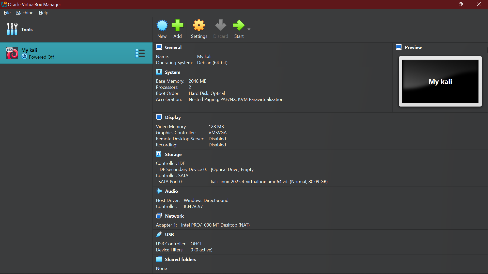
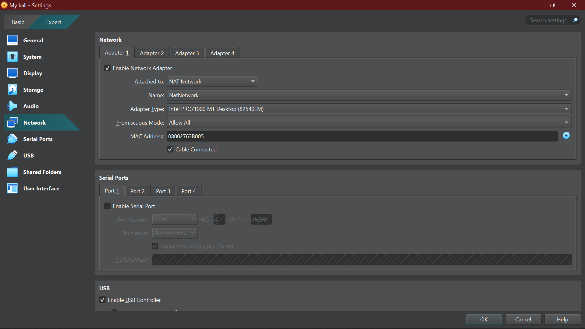
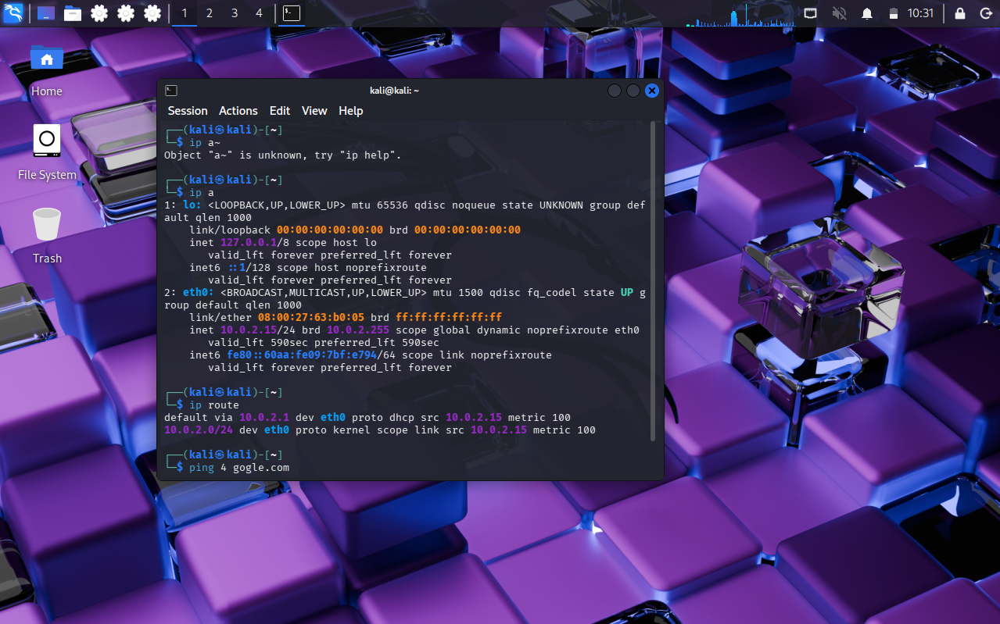
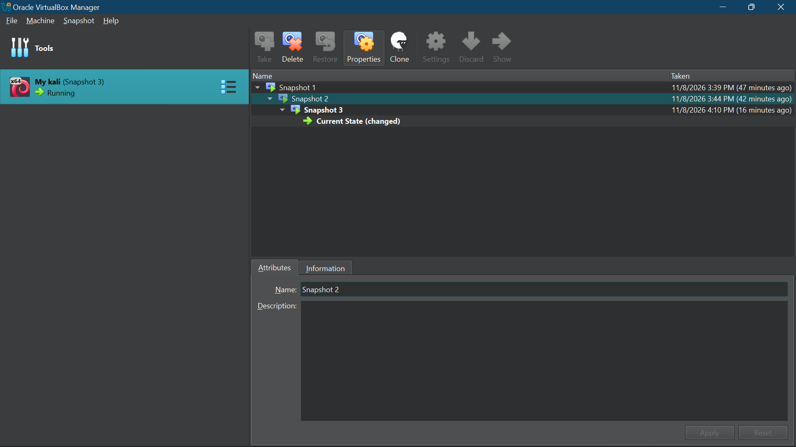

# Cybersecurity Lab Environment Setup

**Building an isolated virtual lab for penetration testing and ethical hacking practice**

  
  
  
  
  
  
  
  
  
  

---

## Project Overview

This project focuses on setting up a **virtual cybersecurity and penetration-testing laboratory** using VirtualBox and Kali Linux. The lab creates a controlled environment where you can safely and repeatedly use cybersecurity tools for network scanning, reconnaissance, vulnerability assessment, and other security-testing activities. The lab is configured on a private virtual network so you can add additional machines later and use them as targets for authorized security testing.

---

## Purpose
The purpose of this project is to establish a safe and controlled virtual cybersecurity lab environment using VirtualBox and Kali Linux. This environment will provide a platform for practising cybersecurity techniques, testing security tools, performing network analysis, and developing practical skills in ethical hacking and network security.

---

## Objectives

The main objectives I achieved in this project are to:
- Install and configure Oracle VirtualBox.
- Download and set up Kali Linux.
- Create and configure a NAT Network.
- Assign and configure the Kali Linux IP address.
- Test network connectivity.
- Create a virtual machine snapshot.
- Establish a functional environment for cybersecurity practical exercises.

## Tools Used
- Kali Linux 2025.4
- Oracle VirtualBox
- NAT Network

## Network Configuration

The following network configuration was identified on the Kali Linux virtual machine:

- Network Name: `NatNetwork`
- Network type: `Nat Network`
- Network Subnet: `10.0.2.0/24`
- Default Gateway: `10.0.2.1`
- Kali IP: `10.0.2.15/24`

---

## Network Verification

The network configuration was checked using Linux terminal commands.

Command used:
ip route

Observed output:
default via 10.0.2.1 dev eth0 proto dhcp src 10.0.2.15 metric 100
10.0.2.0/24 dev eth0 proto kernel scope link src 10.0.2.15 metric 100

This confirmed the default gateway, network subnet, and assigned IP address of the Kali Linux virtual machine.

---

## Tasks Completed
- Configured the VirtualBox NAT Network.
- Configured Kali Linux networking.
- Tested internet connectivity and DNS resolution.
- Enabled clipboard and drag-and-drop.
- Configured a shared folder.
- Created a VM snapshot.

---

## Screenshot and Evidences

The evidence includes:

### 1 Oracle VirtualBox interface.

### 2 Kali Linux Desktop Environment.

### 3 VirtualBox network configuration.

### 4 NAT adapters 

### 5 Internet configuration

### 6 Virtual machine snapshot.

##  Conclusion

The cybersecurity lab environment was established using Oracle VirtualBox and Kali Linux. The setup provides a controlled virtual environment for practising cybersecurity techniques, conducting network analysis, and exploring penetration-testing tools.

This environment serves as a foundation for future hands-on cybersecurity exercises, network security assessments, and practical ethical hacking activities.
